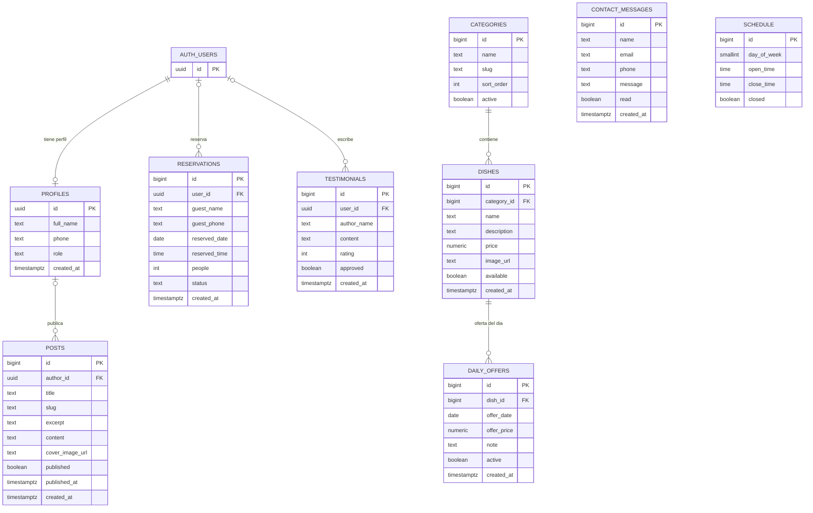

# Modelo de datos

Documento del esquema de base de datos del restaurante (Supabase / PostgreSQL).
Origen: migración `supabase/migrations/0001_init.sql` (ELE-8).

## Diagrama entidad-relación

`auth.users` es la tabla de autenticación de Supabase (no se crea en esta migración).

## Tablas

### profiles
Datos de cada usuario, ligados a su cuenta de login.

| Columna | Tipo | Restricciones |
|---|---|---|
| id | uuid | PK, FK a `auth.users(id)` con `on delete cascade` |
| full_name | text | opcional |
| phone | text | opcional |
| role | text | no nulo, default `'cliente'`, check `('cliente','admin')` |
| created_at | timestamptz | no nulo, default `now()` |

### categories
Secciones del menú.

| Columna | Tipo | Restricciones |
|---|---|---|
| id | bigint | PK, identity |
| name | text | no nulo, único |
| slug | text | no nulo, único |
| sort_order | int | no nulo, default 0 |
| active | boolean | no nulo, default `true` |

### dishes
Platos del menú.

| Columna | Tipo | Restricciones |
|---|---|---|
| id | bigint | PK, identity |
| category_id | bigint | no nulo, FK a `categories(id)` con `on delete restrict` |
| name | text | no nulo |
| description | text | opcional |
| price | numeric(10,2) | no nulo, check `price >= 0` |
| image_url | text | opcional |
| available | boolean | no nulo, default `true` |
| created_at | timestamptz | no nulo, default `now()` |

Índice: `dishes_category_id_idx` sobre `category_id`.

### daily_offers
Ofertas o plato del día.

| Columna | Tipo | Restricciones |
|---|---|---|
| id | bigint | PK, identity |
| dish_id | bigint | no nulo, FK a `dishes(id)` con `on delete cascade` |
| offer_date | date | no nulo |
| offer_price | numeric(10,2) | opcional, check `>= 0` |
| note | text | opcional |
| active | boolean | no nulo, default `true` |
| created_at | timestamptz | no nulo, default `now()` |

Restricción: `unique (dish_id, offer_date)`. Índice: `daily_offers_date_idx`.

### reservations
Reservas de mesa, de usuarios registrados o invitados.

| Columna | Tipo | Restricciones |
|---|---|---|
| id | bigint | PK, identity |
| user_id | uuid | FK a `auth.users(id)` con `on delete set null` (null = invitado) |
| guest_name | text | opcional |
| guest_phone | text | opcional |
| reserved_date | date | no nulo |
| reserved_time | time | no nulo |
| people | int | no nulo, check entre 1 y 20 |
| status | text | no nulo, default `'pendiente'`, check `('pendiente','confirmada','cancelada')` |
| created_at | timestamptz | no nulo, default `now()` |

Consistencia: `reservations_owner_chk` exige `user_id` o, si es invitado, `guest_name` y `guest_phone`.
Índices: `reservations_slot_idx` sobre `(reserved_date, reserved_time)` ignorando canceladas, y `reservations_user_idx` sobre `user_id`.

### contact_messages
Mensajes del formulario de contacto.

| Columna | Tipo | Restricciones |
|---|---|---|
| id | bigint | PK, identity |
| name | text | no nulo |
| email | text | no nulo |
| phone | text | opcional |
| message | text | no nulo |
| read | boolean | no nulo, default `false` |
| created_at | timestamptz | no nulo, default `now()` |

### testimonials
Opiniones de clientes; se muestran solo si están aprobadas.

| Columna | Tipo | Restricciones |
|---|---|---|
| id | bigint | PK, identity |
| user_id | uuid | FK a `auth.users(id)` con `on delete set null` |
| author_name | text | no nulo |
| content | text | no nulo |
| rating | int | no nulo, default 5, check entre 1 y 5 |
| approved | boolean | no nulo, default `false` |
| created_at | timestamptz | no nulo, default `now()` |

### posts
Entradas de blog o novedades.

| Columna | Tipo | Restricciones |
|---|---|---|
| id | bigint | PK, identity |
| author_id | uuid | FK a `profiles(id)` con `on delete set null` |
| title | text | no nulo |
| slug | text | no nulo, único |
| excerpt | text | opcional |
| content | text | no nulo |
| cover_image_url | text | opcional |
| published | boolean | no nulo, default `false` |
| published_at | timestamptz | opcional |
| created_at | timestamptz | no nulo, default `now()` |

Índice: `posts_published_idx` sobre `(published, published_at desc)`.

### schedule
Horario de atención semanal.

| Columna | Tipo | Restricciones |
|---|---|---|
| id | bigint | PK, identity |
| day_of_week | smallint | no nulo, único, check entre 0 y 6 (0 = domingo) |
| open_time | time | opcional |
| close_time | time | opcional |
| closed | boolean | no nulo, default `false` |

Consistencia: `schedule_hours_chk` exige `open_time` y `close_time` cuando `closed` es `false`.

## Vista

### reservation_slot_usage
Calcula el cupo ocupado por franja. No cuenta reservas canceladas.

| Columna | Descripción |
|---|---|
| reserved_date | Fecha de la franja |
| reserved_time | Hora de la franja |
| reservations_count | Cantidad de reservas |
| people_total | Suma de personas |

## Relaciones

| Origen | Destino | Cardinalidad | Al borrar el destino |
|---|---|---|---|
| profiles.id | auth.users.id | 1 a 0..1 | cascade |
| dishes.category_id | categories.id | N a 1 | restrict |
| daily_offers.dish_id | dishes.id | N a 1 | cascade |
| reservations.user_id | auth.users.id | N a 0..1 | set null |
| testimonials.user_id | auth.users.id | N a 0..1 | set null |
| posts.author_id | profiles.id | N a 0..1 | set null |

`contact_messages` y `schedule` no tienen relaciones.

## Pendiente

- Políticas RLS (ELE-9): lectura pública de `categories` y `dishes` disponibles; acceso restringido en el resto.
- Trigger que cree el perfil en `profiles` al registrarse un usuario.
